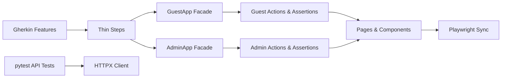

# Python Quality Demo

This project tests a public demo hotel website. It checks administrator login, contact-form validation, a guest enquiry reaching the admin inbox, and two APIs. You do not need to run an application backend, database, or container.

Target application: [Restful Booker Platform](https://automationintesting.online/), maintained by Mark Winteringham and contributors ([official repository](https://github.com/mwinteringham/restful-booker-platform)).

## Quickstart

Prerequisites: **Python 3.12+** and **[uv](https://docs.astral.sh/uv/)**.

```powershell
# 1. Sync dependencies and install Playwright Chromium
uv sync --frozen
uv run playwright install chromium

# 2. Verify test discovery (exactly 6 cases collected)
uv run pytest --collect-only -q

# 3. Run the five non-writing verification tests
uv run pytest -m "not writes_data"

# 4. Run the API contract tests (no browser needed)
uv run pytest -m api
```

## Six-Case Scope

The suite collects exactly six independent tests:

| ID | Purpose | Interface / Target | Markers |
| --- | --- | --- | --- |
| **T01** | Successful administrator sign-in | UI: `/admin` -> `/admin/rooms` | `bdd ui auth smoke` |
| **T02** | Administrator login rejection on invalid password | UI: `/admin` error alert | `bdd ui auth negative` |
| **T03** | Required-field validation feedback on empty submission | UI: Contact form required fields | `bdd ui negative` |
| **T04** | Guest enquiry reaches administrator inbox | UI: Contact submission -> `/admin/message` | `bdd ui e2e writes_data` |
| **T05** | Public room-list API contract verification | API: `GET /api/room` | `api smoke` |
| **T06** | Missing enquiry subject rejected | API: `POST /api/message` | `api negative` |

## Target Limitations and Cleanup Status

During target verification on 31 October 2026:
- The public `POST /api/message` submission creates records and displays them in `/admin/message`.
- However, `DELETE /api/message/{id}` on the public hosted instance currently returns **HTTP 500**.
- In **T04**, the framework submits the enquiry, verifies that it appears in the administrator inbox, and attempts authenticated cleanup in teardown. When the hosted backend returns HTTP 500, teardown writes an owned-record manifest under `artifacts/owned-records/<run_id>/<worker_label>/` and raises an explicit teardown error.
- To run a completely green validation suite, select the five non-writing cases: `uv run pytest -m "not writes_data"`.

## Architecture Overview



- **Facades**: `GuestApp` and `AdminApp` group actions and assertions for each interface.
- **Actions vs Assertions**: Workflows in actions, retrying `expect()` assertions in assertions.
- **Pages**: Locators and UI interactions belong exclusively in page objects.
- **Data Isolation**: Unique enquiry subjects generated per run, worker, and scenario (`qp-<run>-<worker>-T04-<rand>`).

## Command-Line Runner

The custom `quality-demo` CLI translates flags into pytest arguments:

```powershell
# Dry run
uv run quality-demo --target demo --markers e2e --dry-run

# Run with custom worker count
uv run quality-demo --target demo --markers smoke --workers 1
```

## Quality & Documentation

```powershell
# Code quality and formatting checks
uv run poe check

# Build documentation in strict mode
uv run poe docs-build

# Serve documentation locally
uv run poe docs
```

For in-depth details, see the [`docs/`](docs/) directory:
- [Getting Started](docs/getting-started.md)
- [Project Architecture Map](docs/project-map.md)
- [Writing & Extending Tests](docs/writing-tests.md)
- [Running Tests & Results](docs/running-and-results.md)
- [Troubleshooting](docs/troubleshooting.md)
- [Target Notes & Observations](docs/target-notes.md)
