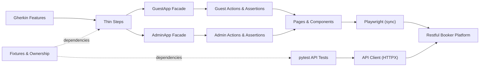

# Project Map

This document describes how the automation architecture is structured, how the layers interact, and how a scenario flows from Gherkin feature to browser execution.

## Architecture Diagram

## Layer Responsibilities

| Layer | Responsibility | What Stays Out |
| --- | --- | --- |
| **Features** (`tests/features/`) | Readable business specifications describing behavior. | Selectors, URLs, HTTP endpoints, assertion assertions. |
| **Steps** (`tests/bdd/steps/`) | Glue code passing typed domain data to facades. | Locators, element clicks, raw HTTP requests. |
| **Facades** (`src/quality_demo/apps/`) | Single entry point for an interface; groups `.actions` and `.assertions`. | Cross-application workflow orchestration. |
| **Actions** | User-intent workflows executing page operations. | Direct element selectors or assertion logic. |
| **Assertions** | Outcome verification using retrying `expect(...)` matchers. | Arbitrary sleeps or raw text scrapers. |
| **Pages & Components** (`src/quality_demo/ui/`) | Locators, selectors, element interactions. | Business logic and scenario flow. |
| **API Client** (`src/quality_demo/api/client.py`) | HTTP calls, host-scoped cookie authentication, timeouts. | Browser dependencies or hidden test assertions. |

## The Vertical Slice (T04) Path

Scenario: *Guest enquiry appears in the administrator inbox*

1. **Test Registration & Fixture Setup**:
   `owned_enquiry` fixture generates a unique `Enquiry` object using `build_enquiry()` and registers ownership with `OwnershipRegistry`.
2. **Anonymous Guest Context**:
   `guest_app.actions.open_contact_form()` opens the public homepage in an isolated, anonymous browser context.
3. **Guest Submission**:
   `guest_app.actions.submit_enquiry()` fills all five fields and submits.
4. **Guest Assertion**:
   `guest_app.assertions.acknowledgement_visible()` asserts the personalized message `"Thanks for getting in touch <name>!"` appears with a retrying assertion.
5. **Separate Admin Context & Sign-In**:
   `admin_app.actions.open_login()` navigates to `/admin` in a completely separate, independent browser context. `admin_app.actions.login()` signs in and verifies the `/admin/rooms` landing.
6. **Admin Inbox Verification**:
   `admin_app.actions.open_inbox()` opens `/admin/message`. `admin_app.assertions.inbox_row_matches()` locates the summary row by the exact unique subject and asserts name and subject match.
7. **Safe Fixture Teardown**:
   In teardown, `api_client` discovers the message ID via `GET /api/message`, re-verifies identity match, and issues an authenticated `DELETE /api/message/{id}`. If the backend returns 500 (known live defect), an owned-record manifest is written under `artifacts/owned-records/` and an explicit teardown error is raised.

## Plain-Language Glossary

- **Facade**: An object that groups the automation actions and assertions for one specific interface (e.g. `GuestApp` or `AdminApp`).
- **Fixture**: A pytest setup and teardown function that provisions dependencies (such as browsers, pages, clients, or test data).
- **Component**: A reusable UI fragment representing repeated page sections (such as an inbox summary row `MessageSummaryRow`).
